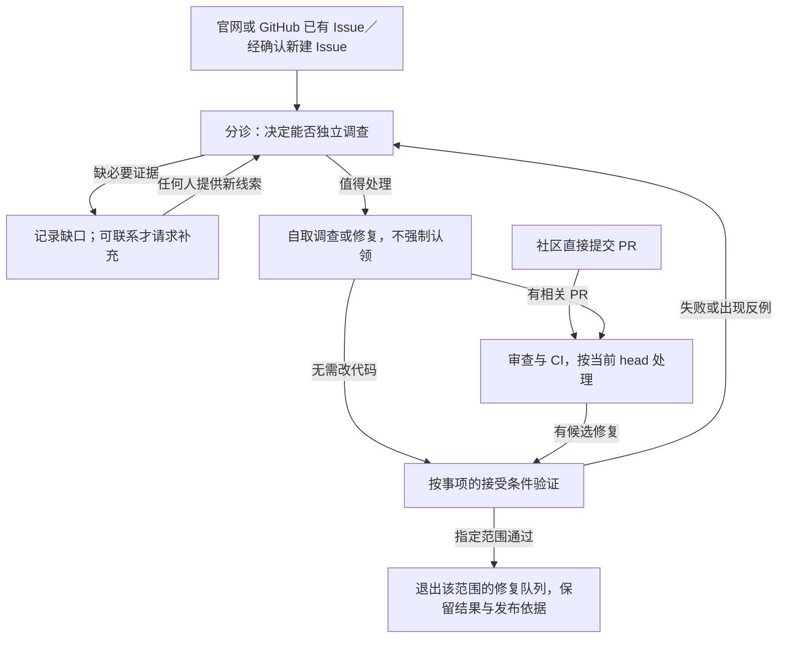

# TernMate 开源项目维护工作台设计方案

状态：Tern Block 已提供 Issue／PR 浏览和 omp 会话、社区收件箱、Issue 提交、个人验收及批次回顾。报告人可以始终只使用 GitHub 或项目官网；本机记录不替代团队决定。

## 1. 设计决策

**维护的单位是一件可以核验的事，不是 GitHub 的一个开关。** 浏览行保留原始 Open／Closed；旁边另列下一动作与依据。默认从现有 Issue／PR 列表进入社区收件箱，不强制指派、排期或关单。项目采用批次管理时才开启批次回顾。一个已有明确修复的开放 Issue 不应该因为 `Open` 而继续被推荐开发。

## 2. 从投稿到反馈

- **提交：** 先选目标仓库与渠道。FD 可选择 Bug／建议模板、官网反馈、FAQ 或投票；不绕过禁用空白 Issue 的规则。标题相似只提示可能重复，不阻止回归报告。只有预览并明确确认才创建一条 Issue；网络结果未知先核对回执，不自动再发。外部已提交的不要求重填；敏感材料转私密渠道。详见[提交协议](design.md#issue-提交协议独立写入功能)。
- **接收：** 咨询、重复、不采纳可以用答复、原件链接或理由结案；无需经过开发阶段。没有关闭引用的 PR 独立进入审查，不推断它没有前期讨论。发布后由原事项或关联回归报告继续跟踪；无报告人回信也可由他人复验。

## 3. 四个实际问题的处理契约

| 情况 | 界面与数据行为 | 禁止的推断 |
| --- | --- | --- |
| 信息不全、报告人不可达 | 展示「可独立调查」或「缺证暂存」及一个具体缺口，例如“缺浏览器版本和触发样例”。只有存在已发出的请求才显示「已请求补充」。新证据到达提示复核 | 官网代发账号不等于实际报告人；没有回信不等于无法复现或问题不存在 |
| 没有负责人，开发者可不登记 | 可直接进 omp；「我在看」是可撤销的本机书签。公开认领、相关 PR 和本机书签分别显示，没有记录写「未见接手信号」 | 不用打开会话、最后评论人或 PR 作者推断整条 Issue 的负责人；不锁单、不自动催办 |
| 做完但 Issue 仍开放 | 修复声明标明“自述”；有可定位的候选修复且对应原症状，进入「待验证」。指定范围验收通过后从该范围的开发／验收队列移出，仍可用「开放＋已验证」找到 | 关联 PR、合并、关单、CI 绿均不能独自触发验收通过；不要求维护者为清空队列关单 |
| 原报告人不能复测 | 验收人可以是开发者、其他贡献者、维护者或报告人。记录证据来源，分开显示作者自测和独立复测；仓库明确要求独立复测时，自测不能替代 | 不证明“所有环境都没问题”，不把没条件验证写成失败或通过 |

## 4. 收件箱和任务详情

默认保留「全部」和原 Issue／PR 筛选；提供「待分诊」「缺证暂存」「执行卡点」「待验证」「验证受限」「已验证」快捷视图。队列是事实上的筛选条件，不是可拖动、互斥的状态。长期反馈帖以具体症状及接受条件分别判定；某子项通过不隐藏其他未决事项。无完整扫描时徽标只标已知数量。

行示例（假设）：`#NN  重启后选择丢失 ｜ Open ｜ 待 Windows 复测 ｜ 有关联修复`。点行或 Enter 打开原任务 omp；点「依据」展开接受条件、来源与版本；点具名 PR 才进对应 worktree。若审查决定、未解决线程、CI 或合并冲突需处理，分别显示；当前 head 无核对证据则标未知。由 PR 标题提取的工作流标记不覆盖 GitHub 事实。

项目级维度保留来源：FD 的 `【830】【待批准方案】` 分别映射为标题批次、待决阶段；Bug 表单的报告版本不参与该映射。另一个仓库可用 milestone。批次不是承诺，没有开批基线就只盘点；不启用批次也不影响独立 PR、Issue 提交或验收。

## 5. 验收记录与判定

验收单只记录回答“原症状是否仍存在”所需的信息，不复制整段会话或日志：

| 字段 | 判定用途 |
| --- | --- |
| 事项身份、子问题、原始接受条件及来源 | 锁定验证对象；接受条件变更保留旧记录，不能事后放宽 |
| 环境、输入与步骤、候选构建／提交 | 让其他人能在同一条件下重复；区分本机构建、PR head 与已发布版本 |
| 预期、实际、旧版对照或无法对照的原因 | 优先在同条件下验证修复前失败、修复后通过；偶发问题记录尝试次数和触发条件，一次未出现不能替代充分复测 |
| 验证者、时间、证据链接、结论与限制 | 结论只有「指定范围通过／失败／受限」。通过需有观察结果；失败返回调查；受限记录缺哪个环境或输入 |

例如，FD 风格的 Windows 持久化缺陷应在目标构建上**实际重启应用**再核对选择是否保留，不以 Linux 单测代替。新版若再次复现，新增带版本的失败记录；旧版本已通过的记录不覆盖、不外推。发布单列渠道、制品与变更关联，下载页存在不证明修复已发给用户。

## 6. 数据归属、接入点与权限

- GitHub 字段、公开认领、复测评论和发布记录是远端事实；模板或标题映射是仓库约定；本机书签、草稿和本地复测是个人数据。给每条证据标明来源、对象、范围、版本和观察时间。验收以已有团队记录为准；用户也可在本机填写验收单并复制脱敏草稿，本机结论不冒充公开决定。对含多个症状的 Issue，只按明确选定的子项归档。
- `github.luau` 按需读取轻量事实，按仓库分页；打开详情再取讨论和关联证据。归类逻辑从事实导出队列，不做“最后评论者就是在等谁”的猜测。切仓、换条件或 PR head 变化时不应用旧响应；部分／不可读与空结果分开。
- `host.luau` 负责视图与选择。草稿和书签只存插件私有目录；个人记录按主机、仓库、对象、用户隔离；核对 checkout 后复用 `sessions.luau` 与 `materials.luau` 启动任务。远端正文是数据而非命令，不执行不可信 PR 脚本，不启用自动批准。
- 收件箱、书签、复测和批次盘点默认不写 GitHub。一次确认新建 Issue 不授权发评论、贴标签、指派、关单、推送、重跑 CI、合并或发布。退出工作台不删除本地工作树。

## 7. 实施顺序与放行条件

1. **先上线只读收件箱。** 在同一 FD 快照下与维护者独立清单对照，验证不可达报告人、无人认领、直接 fork PR、机器人回执、旧审查和新 head。不能解释“为何在此队列”的条目显示待核对，不推广自动分类。
2. **打通提交和自取。** 在专用测试仓库验证模板、原生入口交接、草稿恢复、双击一次创建以及丢回执不重发。开发者不点书签也能工作；另一用户看不到私有标记。不得向 FD 试发测试单。
3. **打通验收与反馈。** 对一个保持开放、含两个症状的 Issue，验证其中一个不会隐藏另一个；目标平台不可得必须受限，实际复测失败能回调查，验证通过不能触发关单。本机自测与公开复验可区分。
4. **最后启用批次结算。** 用 FD `830` 做只读回顾，另选新批次冻结真实承诺；无基线不算兑现率，再以 milestone 仓库验证可迁移。关闭该功能后前三条路径继续可用。

交付门槛是真实 Tern 面板跑通这些场景；本文件不是运行结果。管理依据和样本口径见[管理手册](project-management.md)与[开源场景研究](maintenance-research.md)。
